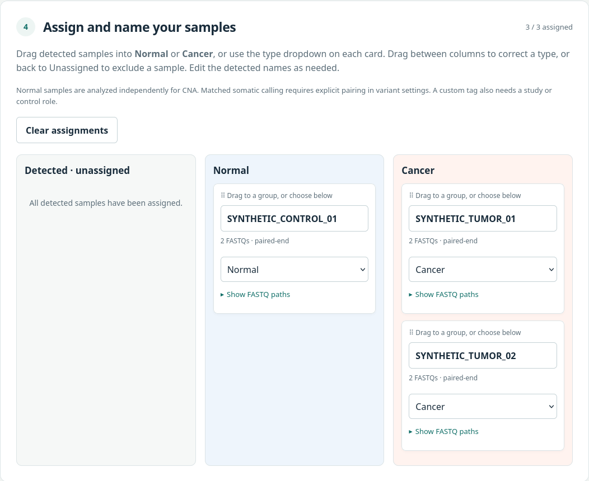

# OncoTracer

[](https://github.com/cfarkas/oncotracer/releases) [](https://cfarkas.github.io/oncotracer/) [](https://github.com/cfarkas/oncotracer/actions/workflows/native-v2-ci.yml)

Analyze Illumina and Oxford Nanopore (ONT) copy-number changes and small variants. ONT methylation supports MARLIN leukemia and Sturgeon CNS-tumor classifiers. For research use.

## Quick start

Use Linux and Python 3.10–3.13. No Git checkout is required. Install in your Python environment:

```bash
python3 -m pip install --upgrade --force-reinstall "https://github.com/cfarkas/oncotracer/releases/download/v4.0.0/oncotracer-4.0.0-py3-none-any.whl"
```

OncoTracer 4.0.0 includes safe dynamic ONT scheduling and prompt reporting of failed sample workers. The full FFPE/ONT/fresh benchmark is being rerun from raw reads; its completion is reported separately. The command `pip install oncotracer` follows the separately published PyPI version. Choose **one** backend:

### Conda

With [Conda](https://github.com/conda-forge/miniforge#install) available:

```bash
oncotracer install --conda
oncotracer doctor --backend conda
oncotracer --interactive --backend conda
```

### Docker

With Docker running and accessible:

```bash
oncotracer install --docker --image carlosfarkas/oncotracer:4.0.0
oncotracer doctor --backend docker
oncotracer --interactive --backend docker
```

The image is saved for later commands. See [installation](docs/installation.md) and [FFPE/ONT resources](docs/variants.md). Use Conda for ONT methylation.

Use `oncotracer --detect-resources` (also `--detect_resources`) for [sample jobs × cores per sample](docs/MULTISAMPLE_QUICKSTART.md) based on CPU/RAM. Choose the allocation during setup or **Review and run**.

The [4.0.0 release notes](docs/releases/4.0.0.md) describe the scheduler correction, corrected reference-CpG aggregation and evidence-gated ichorCNA rescue. New projects use the [sensitive CNA profile](docs/cna_evidence_assessment.md) with read-support checks; existing settings persist. Options: `--resource-mode fixed` and `--no-merge-vcfs`.

For supported stages, install with `--gpu`, check with `doctor --gpu`, then choose **GPU usage → Yes**. See [GPU setup and memory limits](docs/gpu.md).

### Interactive setup with Nextflow

From the [source checkout](docs/installation_details.md#install-from-github), Nextflow opens the same interface:

```bash
nextflow run main.nf --interactive --backend conda
```

Use the full path to `main.nf` from another directory, or `--backend docker` for Docker. Analysis starts only after **Run analysis**. [Nextflow and concurrent projects](docs/nextflow_entry.md).

## Recorded study commands

The 4.0.0 benchmark starts from original FASTQs with empty result directories. Public reference indexes and models may be reused. Completion and measured performance will be published after all three cohorts pass validation.

```bash
oncotracer run --config /path/to/FFPE/config/run.yml --backend conda --cpu --resource-mode dynamic --storage-mode compact
oncotracer run --config /path/to/ONT/config/run.yml --backend docker --image carlosfarkas/oncotracer:4.0.0 --cpu --resource-mode dynamic --storage-mode compact
oncotracer run --config /path/to/Fresh/config/run.yml --backend conda --cpu --resource-mode dynamic --storage-mode compact
```

The interrupted 3.0.0 attempt is not a successful benchmark. See [release notes](docs/releases/4.0.0.md) for the correction and validation scope.

## Set up your analysis

1. Choose **Illumina or ONT**, then **Fresh or FFPE**.
2. Select input files, assign samples to Normal or Cancer, and choose the analysis and project folder.
3. Review settings, select **Save configuration and check**, then **Run analysis**.

Keep the terminal open and use its complete printed URL, including the code after `#`. Concurrent projects use separate terminals, ports and output folders; share CPU and RAM between them.

## Interactive demo

[](https://cfarkas.github.io/oncotracer/assets/setup-demo/index.html)

[Try the demo](https://cfarkas.github.io/oncotracer/assets/setup-demo/index.html) with synthetic samples and simulated execution. See the [browser walkthrough](docs/browser_demo.md) for the sequence.

### Continue an existing analysis

Use `oncotracer --interactive --project /path/to/existing-project`. Load saved settings, then choose parallel sample jobs in **Review and run**. **Run analysis** applies and checks your selection. See [intermediate checks and relocation](docs/running.md#resume-behavior).

[Sturgeon setup](docs/configuration/methylation_reference.md#sturgeon-pretrained-model-setup) offers the pretrained general model and hg38 probes after explicit license acknowledgement.

### ONT input layout

With the [current GitHub source](docs/installation_details.md#install-from-github), select `ONT/` with **one named folder per intended library**. Folder names become sample names; keep multiple libraries separate even when they share a patient.

```text
ONT/
├── ONCO-001/
│   ├── fastq_pass/
│   ├── fastq_fail/
│   ├── pod5_pass/
│   ├── pod5_fail/
│   └── bam_pass/       # or modified_bam/
└── ONCO-002/
    ├── fastq_pass/
    ├── fastq_fail/
    ├── pod5_pass/
    ├── pod5_fail/
    └── bam_pass/       # or modified_bam/
```

Methylation automatically links each named library's `pod5_pass`. The browser
lists its library name; assign MARLIN or Sturgeon using clinical records.
Matching modified-base BAMs are alternatives.

Only `fastq_pass` supplies CNA/variant reads. Other folders are optional. Retain original signal for methylation: use
matching modified-base BAMs with `MM`/`ML` tags, or POD5 with compatible Dorado
models. Legacy single MinKNOW runs, barcode folders and single ligation libraries
remain supported. See [ONT settings](docs/configuration/ont.md) and the
[CpG guide](docs/post_ont_cpg.md).
### Run saved settings

```bash
oncotracer check --config "$PWD/my-study/config/run.yml"
oncotracer run --backend conda --config "$PWD/my-study/config/run.yml"
```

For Docker, use `--backend docker`. Terminal setup and SSH are covered in the [headless guide](docs/headless.md).

Remove installed components with the [uninstall guide](docs/uninstall.md).

## Guides and examples

| Task | Guide |
| --- | --- |
| Try public Illumina and ONT data | [QuickStart 1](https://cfarkas.github.io/oncotracer/quick_start/) · [QuickStart 2](https://cfarkas.github.io/oncotracer/public_cohort/) |
| Check hardware or reuse genome indexes | [Requirements](docs/installation.md#requirements) · [Prebuilt indexes](docs/reference_indexes.md) |
| Prepare multiple samples | [Batch setup](docs/auto_params.md) · [Command basics](docs/command_basics.md) |
| Add analysis options | [Methylation](docs/configuration/methylation.md) · [Variants](docs/variants.md) · [Paper report](docs/paper_report.md) |
| Understand results | [Outputs](docs/outputs.md) · [Troubleshooting](docs/troubleshooting.md) |

[Complete documentation](https://cfarkas.github.io/oncotracer/). Optional `run_cna_classifier: true` adds CNA interpretation. Runs record commands and checksums; released builds include `release-provenance.json`.
