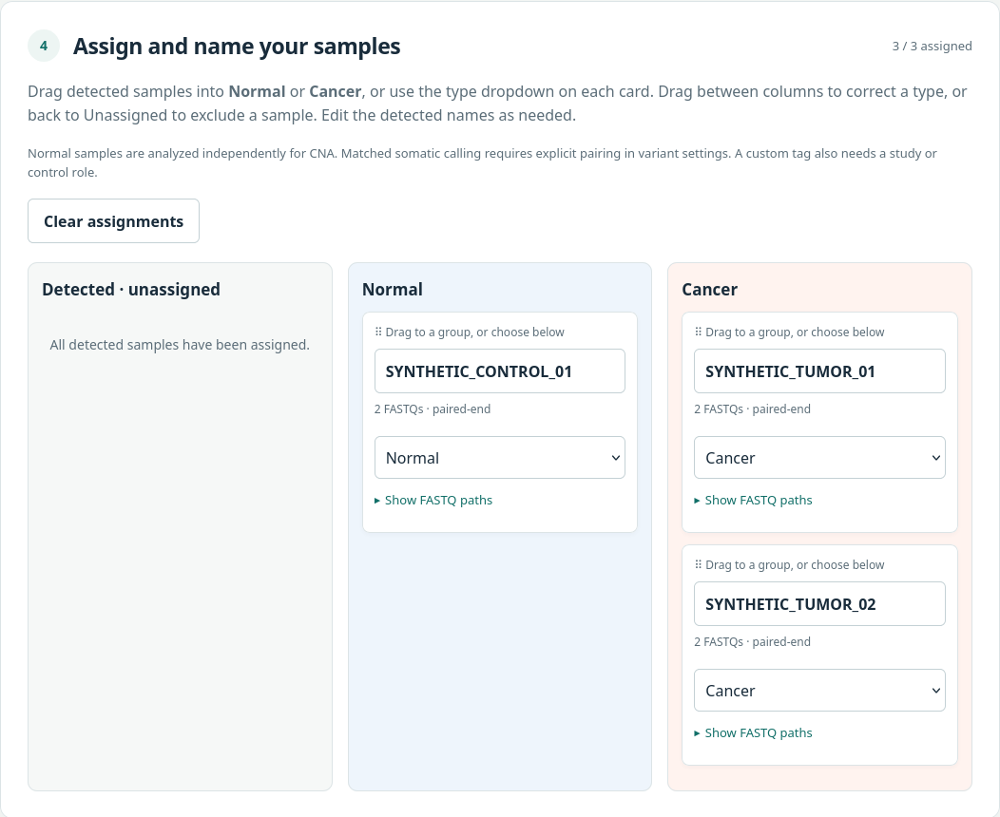

# OncoTracer

[](https://github.com/cfarkas/oncotracer/releases) [](https://cfarkas.github.io/oncotracer/) [](https://github.com/cfarkas/oncotracer/actions/workflows/native-v2-ci.yml)

Analyze Illumina and Oxford Nanopore (ONT) reads for DNA copy-number changes and small variants. Set up samples in your browser, run the analysis, and review tables, plots and reports. ONT methylation supports MARLIN leukemia and Sturgeon CNS-tumor research classifiers. For research use.

## Quick start

Use Linux and Python 3.10–3.13. Install the application in your Python environment:

```bash
pip install oncotracer
```

No Git checkout is required for PyPI. New resource choices require the [current GitHub source](docs/installation_details.md#install-from-github); PyPI 2.1.0 predates them. Choose **one** backend:

### Conda

With [Conda](https://github.com/conda-forge/miniforge#install) available:

```bash
oncotracer install --conda
oncotracer doctor --backend conda
oncotracer --interactive --backend conda
```

### Docker

With Docker running and accessible:

```bash
oncotracer install --docker --image carlosfarkas/oncotracer:multisample-20261020
oncotracer doctor --backend docker
oncotracer --interactive --backend docker
```

The Docker image is saved for later commands. See [installation](docs/installation.md) for Python environments, requirements and other options. FFPE/ONT callers, model resources and ANNOVAR have [additional setup requirements](docs/variants.md); use Conda for ONT methylation.

### Open interactive setup with Nextflow

From the [source checkout](docs/installation_details.md#install-from-github), Nextflow opens the same interface:

```bash
nextflow run main.nf --interactive --backend conda
```

Use the full path to `main.nf` from another directory, or `--backend docker` for Docker. Analysis starts only after **Run analysis**. [Nextflow and concurrent projects](docs/nextflow_entry.md).

## Set up your analysis

1. Choose **Illumina or ONT**, then **Fresh or FFPE**.
2. Select input files, assign samples to Normal or Cancer, and choose the analysis and project folder.
3. Review settings, select **Save configuration and check**, then **Run analysis**.

Keep the terminal open and use its complete printed URL, including the session code after `#`. Open another terminal for another project; each session chooses an available port. Use distinct project/output folders and share the server’s CPU and memory between runs.

Choose CPU/RAM budgets and concurrent sample counts before Run. [Resource selection and verified reuse](https://cfarkas.github.io/oncotracer/MULTISAMPLE_QUICKSTART/).

## Interactive demo

[](https://cfarkas.github.io/oncotracer/assets/setup-demo/index.html)

[Try the demo](https://cfarkas.github.io/oncotracer/assets/setup-demo/index.html) with synthetic samples and simulated execution. See the [browser walkthrough](docs/browser_demo.md) for the sequence.

### Continue an existing analysis

Use `oncotracer --interactive --project /path/to/existing-project`. Load saved settings, choose the CPU/RAM budget and concurrent sample count, then **Apply resources and check** before Run. See [intermediate checks and relocation](docs/running.md#resume-behavior).

[Sturgeon setup](docs/configuration/methylation_reference.md#sturgeon-pretrained-model-setup) offers the pretrained general model and hg38 probes after explicit license acknowledgement.

### ONT input layout

With the [current GitHub source](docs/installation_details.md#install-from-github), select `ONT/` with **one named folder per intended library**. Folder names become sample names; keep multiple libraries separate even when they share a patient.
PyPI 2.1.0 retains the legacy layouts described below.

```text
ONT/
├── ONCO-001/
│   ├── fastq_pass/
│   ├── fastq_fail/
│   ├── pod5_pass/
│   ├── pod5_fail/
│   └── bam_pass/       # or modified_bam/
└── ONCO-002/
    ├── fastq_pass/
    ├── fastq_fail/
    ├── pod5_pass/
    ├── pod5_fail/
    └── bam_pass/       # or modified_bam/
```

Methylation automatically links each named library's `pod5_pass`. The browser
lists its ONCO-style name; drag samples to MARLIN or Sturgeon using clinical
records. Saved or explicitly selected modified-base BAMs remain valid alternatives.

Only `fastq_pass` supplies CNA/variant reads. The other folders are optional;
retain original signal for methylation. FASTQs have no methylation marks: use
matching modified-base BAMs with `MM`/`ML` tags, or POD5 with compatible Dorado
models. Legacy single MinKNOW runs, barcode folders and single ligation libraries
remain supported. See [ONT settings](docs/configuration/ont.md) and the
[CpG guide](docs/post_ont_cpg.md).

### Run saved settings

```bash
oncotracer check --config "$PWD/my-study/config/run.yml"
oncotracer run --backend conda --config "$PWD/my-study/config/run.yml"
```

For Docker, use `--backend docker`. Terminal setup and SSH are covered in the [headless guide](docs/headless.md).

## Uninstall

Remove the backend you installed, then the Python application.

**Conda tools:** permanently remove the managed environments and their matching extra global command:

```bash
oncotracer uninstall --conda --yes --purge
```

**Docker image:** remove the selected image/tag:

```bash
docker image rm carlosfarkas/oncotracer:multisample-20261020
```

This Docker command removes only the image/tag. It does not remove the pip application, an extra global launcher, saved settings, projects or results. Shared image layers may remain.

**Python application:** in the Python environment used for installation:

```bash
python -m pip uninstall oncotracer
```

If an extra OncoTracer-owned global launcher remains, [remove it before the Python application](docs/uninstall.md#global-command). Pip removes its own console entry. See [component-by-component removal](docs/uninstall.md) for custom prefixes, separately installed tools and retained settings. User data and results remain.

## Guides and examples

| Task | Guide |
| --- | --- |
| Try public Illumina and ONT data | [QuickStart 1](https://cfarkas.github.io/oncotracer/quick_start/) · [QuickStart 2](https://cfarkas.github.io/oncotracer/public_cohort/) |
| Check hardware or reuse genome indexes | [Requirements](docs/installation.md#requirements) · [Prebuilt indexes](docs/reference_indexes.md) |
| Prepare multiple samples | [Batch setup](docs/auto_params.md) · [Command basics](docs/command_basics.md) |
| Add analysis options | [Methylation](docs/configuration/methylation.md) · [Variants](docs/variants.md) · [Paper report](docs/paper_report.md) |
| Understand results | [Outputs](docs/outputs.md) · [Troubleshooting](docs/troubleshooting.md) |

[Complete documentation](https://cfarkas.github.io/oncotracer/). Optional `run_cna_classifier: true` adds CNA interpretation. Runs record commands and checksums; released builds include `release-provenance.json`.
