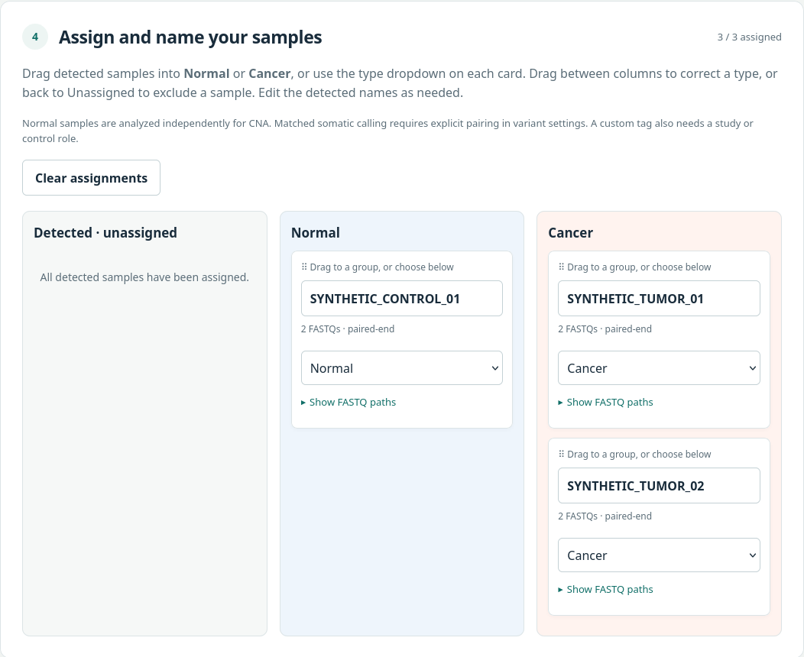

# OncoTracer

[](https://github.com/cfarkas/oncotracer/releases) [](https://cfarkas.github.io/oncotracer/) [](https://github.com/cfarkas/oncotracer/actions/workflows/native-v2-ci.yml)

Analyze Illumina and Oxford Nanopore (ONT) copy-number changes, small variants and ONT methylation. Version 6 prepares a project through interactive browser setup or one sample table, downloads its references and runs the tools in Docker. For research use.

## Quick start

You need **Linux x86-64, Python 3.10–3.13 and [Docker Engine](https://docs.docker.com/engine/install/)**. No Git checkout is required. [Installation details](docs/installation.md):

```bash
python3 -m venv oncotracer-env
source oncotracer-env/bin/activate
python -m pip install "https://github.com/cfarkas/oncotracer/releases/download/v6.0.0/oncotracer-6.0.0-py3-none-any.whl"
```

Use the release wheel above; `pip install oncotracer` follows the separate PyPI release.

### Interactive setup (recommended)

Start the browser setup:

```bash
oncotracer --interactive --backend docker
```

Choose Illumina or ONT, select your inputs and project folder, then review the configuration and click **Run analysis**. Keep the terminal open while using the browser. [Browser walkthrough](docs/browser_demo.md) · [Connecting over SSH](docs/headless.md).

### Run from a sample table

Create `samples.csv`. Paths can be relative to this table:

```bash
cat > samples.csv <<'CSV'
sample,fastq_1,fastq_2,status
CASE_01,reads/case_R1.fastq.gz,reads/case_R2.fastq.gz,tumor
NORMAL_01,reads/normal_R1.fastq.gz,reads/normal_R2.fastq.gz,normal
CSV
```

Run fresh Illumina data:

```bash
oncotracer launch --samples samples.csv --project my-run --specimen fresh
```

The first run pulls the image and prepares verified references. Later runs reuse the cache. CPU and memory allocations are detected automatically; use `--dry-run` to inspect them without downloading or writing anything. Results go to `my-run/results`; the full configuration is saved in `my-run/config/run.yml`. Repeat the launch command to resume.

### ONT and FFPE

For ONT, use `sample,library,status,tissue` columns. Each library folder contains its own `fastq_pass` and `pod5_pass`. Use tissue from specimen records: `blood`, `bone marrow` or `CNS`. [Sample tables and options](docs/launch.md) include Modkit inputs and multiple Illumina lanes.

```bash
oncotracer launch --samples ont.csv --project ont-run --specimen fresh --methylation
oncotracer launch --samples ffpe.csv --project ffpe-run --specimen ffpe --accept-ffperase-license
```

Review [FFPErase terms](https://github.com/papaemmelab/nf-ffperase/blob/b0dd56cbd0a939896a966b9ce30c4d719b158170/LICENSE) before accepting. CNS classification similarly requires `--accept-sturgeon-license` after reviewing the [Sturgeon license](https://github.com/UMCUGenetics/sturgeon/blob/main/LICENSE). Its software and model are prepared privately. MARLIN and the permitted caller runtimes are supplied by Docker. Rockfish is the default; `--methylation-caller modkit` reuses modified-base BAMs. Compatible raw signal remains necessary for Rockfish.

Version 6 retains ichorCNA fallback, Broad profiles and coarse rescues. See [release details](docs/releases/6.0.0.md) and [CNA evidence](docs/cna_evidence_assessment.md). GPU methylation also requires the [NVIDIA container setup](docs/gpu.md).

## Run a saved project

```bash
oncotracer run --config /path/to/project/config/run.yml --backend docker
```

Keep the recorded version for existing v5 results; use a new output directory for v6 validation. Conda remains supported through `oncotracer install --conda` and `oncotracer --interactive --backend conda`.

## Set up your analysis

Prefer a browser? Run `oncotracer --interactive --backend docker`.

1. Choose **Illumina or ONT**, then **Fresh or FFPE**.
2. Select inputs, assign sample roles and choose the analysis/project folder.
3. Save, review the checks and select **Run analysis**.

Docker prepares methylation resources automatically. Keep the terminal open and use its complete URL. [Browser walkthrough](docs/browser_demo.md) · [Nextflow entry](docs/nextflow_entry.md) · [SSH setup](docs/headless.md).

## Interactive demo

[](https://cfarkas.github.io/oncotracer/assets/setup-demo/index.html)

[Try the demo](https://cfarkas.github.io/oncotracer/assets/setup-demo/index.html). It uses synthetic samples and simulated execution.

## Guides and examples

| Task | Guide |
| --- | --- |
| Prepare your first sample table | [Launch a project](docs/launch.md) |
| Try public Illumina and ONT data | [QuickStart 1](https://cfarkas.github.io/oncotracer/quick_start/) · [QuickStart 2](https://cfarkas.github.io/oncotracer/public_cohort/) |
| Check hardware or reuse genome indexes | [Requirements](docs/installation.md#requirements) · [Prebuilt indexes](docs/reference_indexes.md) |
| Use Conda or develop the application | [Installation details](docs/installation_details.md) |
| Understand results | [Outputs](docs/outputs.md) · [Troubleshooting](docs/troubleshooting.md) |

Runs record commands and checksums; released builds include `release-provenance.json`. Full launch includes CNA interpretation (`run_cna_classifier: true`), variants and imputation. Use `--analysis cna` for CNA alone. [Complete documentation](https://cfarkas.github.io/oncotracer/).

## Real benchmark runs

Commands from the **58-sample version 5 benchmark**. The linked YAMLs retain recorded settings with placeholder paths and identifiers. See [configuration instructions and input tables](examples/benchmark_v5/README.md) and [measured timings, resources and QC](docs/benchmarks/2026-11-23.md).

Budgets are cohort-wide; reduce them for smaller machines. Memory settings are in each YAML. The benchmark additionally enforced Linux memory limits separately.

### ONT — 21 samples

[ONT/config/run.yml](examples/benchmark_v5/ONT/config/run.yml) · **66 threads**, **4 parallel samples**, **360 GiB RAM**. Methylation: **RTX A5000, 24 GiB VRAM**. Alignment/variants: CPU.

```bash
oncotracer run --config /path/to/ONT/config/run.yml --backend docker --image carlosfarkas/oncotracer:5.0.0 --methylation --methylation-caller rockfish --threads 66 --parallel-samples 4 --no-merge-vcfs --resource-mode dynamic --storage-mode compact --cna-profile sensitive
```

### FFPE Illumina — 26 samples

[FFPE/config/run.yml](examples/benchmark_v5/FFPE/config/run.yml) · **42 threads**, **7 parallel samples**, **400 GiB RAM**, **CPU only**.

```bash
oncotracer run --config /path/to/FFPE/config/run.yml --backend conda --threads 42 --parallel-samples 7 --no-merge-vcfs --cpu --resource-mode fixed --storage-mode compact --cna-profile standard
```

### Fresh Illumina — 11 samples

[Fresh/config/run.yml](examples/benchmark_v5/Fresh/config/run.yml) · **18 threads**, **3 parallel samples**, **176 GiB RAM**, **CPU only**.

```bash
oncotracer run --config /path/to/Fresh/config/run.yml --backend conda --threads 18 --parallel-samples 3 --no-merge-vcfs --cpu --resource-mode fixed --storage-mode compact --cna-profile standard
```
