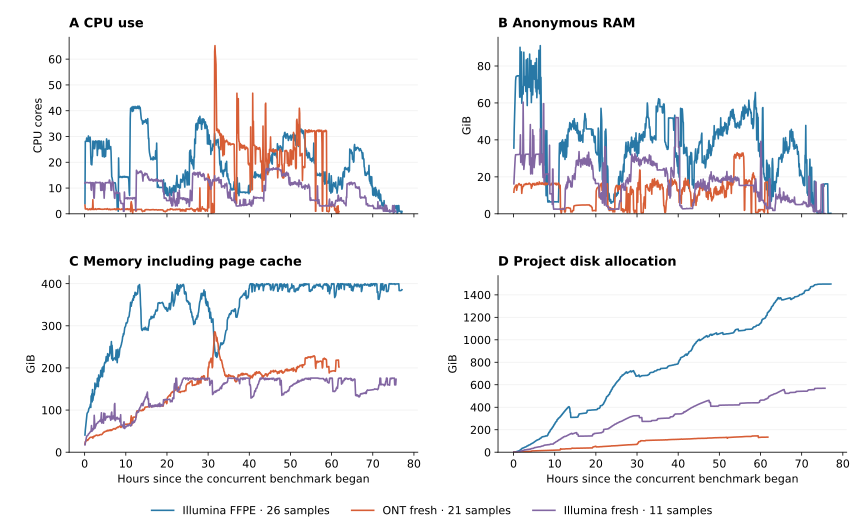

# Version 5 study benchmark — 23 November 2026

Three fresh analyses processed **58 samples**: 26 Illumina FFPE, 11 fresh
Illumina and 21 fresh ONT libraries. All three completed the full output
validation. The ONT workflow intentionally returned exit code **2** because
some sparse samples did not meet its CNA/methylation quality requirements;
this is retained as a QC-limited result, not converted to an all-samples-pass claim.

These are operational and resource measurements. They do not establish variant
sensitivity, tumor-classification accuracy, or clinical validity. There is no
matched completed v4.1 control run, so no end-to-end speedup over v4.1 is claimed.

## Measured build and timing scope

The benchmark ran source commit `76da6c1b707f3ee14f0dc67f7521e394ff934e5d`,
source archive SHA-256
`d5926b562648ead29745cfa465ebd90401286fc1ac8cae9428b6b14a0c385d22`.
The measured ONT Docker image ID was
`sha256:b2f50f3c3cfab45da03357f5c904e46e4897c1c3d1a81ade629cf860fa5fef47`;
this local image ID is not a registry manifest digest. The release records its
own source commit, executable hashes and published image digest separately.
The publication gate checks that scientific runtime source files are unchanged
from the benchmarked commit.

Timing began on **19 November 2026 at 21:43 UTC**. Analyses finished by
23 November; all full output validation finished at **04:17 UTC on 23 November**.
The three cohorts ran concurrently on an AMD EPYC 7713 host with 128 logical
CPUs, approximately 995.5 GiB RAM, and an NVIDIA RTX A5000 with 24 GiB VRAM.
CPU sets and memory limits were assigned separately; storage, reference caches
and background host activity were shared. This is not a dedicated-machine
scaling experiment.

All analyses started again from their FASTQ inputs; ONT methylation additionally
used the selected POD5 signal. Old study alignments, variant calls and imputation
results were not reused. Existing public reference/model caches were retained.
Software installation and initial shared-reference preparation preceded timing.
The timed run includes input/reference verification, analysis, reporting and
finalization. Output validation is measured separately after each analysis exits.

| Cohort | Samples | Backend | Threads / parallel samples | Analysis wall time | CPU core-hours | Output validation |
| --- | ---: | --- | ---: | ---: | ---: | --- |
| Illumina FFPE | 26 | conda | 42 / 7 | 77.10 h | 1450.5 | Passed |
| Illumina fresh | 11 | conda | 18 / 3 | 75.67 h | 658.0 | Passed |
| ONT fresh | 21 | docker | 66 / 4 | 61.79 h | 781.2 | Passed |

## Outcome and quality limits

- **Small variants:** all 58 sample workflows completed. The Illumina traces
  contain 34,008 completed FFPE tasks and 14,388 completed fresh tasks, with no
  cached or failed task rows in those saved traces. Completion is not evidence
  of truth-set sensitivity or specificity.
- **Primary CNA assessment:** 26/26 FFPE, 11/11 fresh Illumina and 7/21 ONT
  samples passed the primary assessment. Six additional ONT samples retained
  a separate coarse relative-profile result. Eight ONT samples remain outside
  these accepted primary/coarse categories. Broad exploratory evidence remains
  explicitly separate from an assessable primary profile.
- **ONT methylation:** 20/21 libraries completed methylation processing;
  one had no usable CpG modifications. The routing configuration assigned 13
  blood/marrow libraries to MARLIN and eight CNS libraries to Sturgeon. Routing
  counts are not accuracy estimates, and a classification is not a clinical
  diagnosis. Rockfish measures binary CpG 5mC, not separate 5hmC or gene expression.
- **Output integrity:** full validation checked **83,249 files**, including
  complete file hashes, final and native caller/imputation artifacts, VCF sample
  identity/indexed counts, PDF parsing and autosomal imputation completeness.
  The checked files total approximately **931.8 GB**. Raw inputs were also checked
  for changes during the benchmark. Validation preserves all scientific QC flags.

## Each recorded step

The table shows the interval from the first command starting to the last command
finishing for a step across the cohort. Parallel samples overlap, and queue gaps
can occur inside an interval; **these spans must not be added to obtain total
wall time**. Dorado and Rockfish had GPU queue waits. The full CSV additionally
reports active interval unions, summed command time, counts, return codes,
median, 95th percentile and maximum command duration.

| Recorded step | Illumina FFPE | Illumina fresh | ONT fresh |
| --- | ---: | ---: | ---: |
| Read alignment | 7.91 h | 9.34 h | 1.07 h |
| Illumina variant workflow | 65.62 h | 64.45 h | — |
| Clair3 calling | — | — | 25.71 h |
| ClairS-TO calling | — | — | 20.78 h |
| QUILT2 imputation | — | — | 26.30 h |
| Dorado move-tagged basecalling | — | — | 29.78 h |
| Rockfish CpG calling | — | — | 18.68 h |
| qDNAseq CNA analysis | 0.76 h | 0.45 h | 0.07 h |
| BAM-supported refinement | 0.42 h | 0.10 h | 0.07 h |
| CNA knowledge annotation | 1.20 h | 0.57 h | 0.77 h |
| Cohort figure | 0.50 h | 0.33 h | 0.04 h |
| Full output validation, after analysis | 1.47 h | 0.22 h | 0.47 h |

The [complete stage table](../assets/benchmarks/2026-11-23-v5/stage_timings.csv)
contains every recorded native and methylation command group, plus Illumina
variant-workflow envelopes and output validation. The
[Nextflow process table](../assets/benchmarks/2026-11-23-v5/nextflow_processes.csv)
breaks Illumina variants down into germline and somatic calling, GLIMPSE reference
preparation/phasing/ligation, annotation, ClinVar, reports and other downstream
processes. It includes completed/cached/failed attempt counts, summed task
realtime, median/95th-percentile timing, maximum requested CPUs/memory and
observed peak RSS. Task-time sums are neither wall time nor measured CPU time.

## Memory, disk and CPU use

| Cohort | Memory budget | Peak anonymous RAM | Peak memory including page cache | Peak allocated project disk |
| --- | ---: | ---: | ---: | ---: |
| Illumina FFPE | 400 GiB | 97.8 GiB | 400.0 GiB | 1496.2 GiB |
| Illumina fresh | 176 GiB | 60.4 GiB | 176.0 GiB | 568.8 GiB |
| ONT fresh | 360 GiB | 37.8 GiB | 291.6 GiB | 145.8 GiB |

Memory including page cache is the complete cgroup charge; it is not synonymous
with application RAM. The anonymous-RAM column is reported separately. Disk
allocation is sampled project usage including temporary work; shared references,
container layers and installation space are additional. Missing host I/O counters
are unavailable measurements, not zero usage. GPU device utilization includes
background processes, so no exclusive GPU-hours or CPU-versus-GPU speedup is claimed.



The plot retains the last observation per five-minute interval. Summary peaks
use the complete resource recorder. Download the
[PDF](../assets/benchmarks/2026-11-23-v5/resource_usage.pdf),
[resource CSV](../assets/benchmarks/2026-11-23-v5/resource_timeseries.csv),
[cohort summary CSV](../assets/benchmarks/2026-11-23-v5/cohort_summary.csv),
[structured summary](../assets/benchmarks/2026-11-23-v5/benchmark_summary.json),
or [source-evidence hashes](../assets/benchmarks/2026-11-23-v5/source_evidence.json).
Public tables contain aggregate measurements, without sample identifiers,
patient variants, clinical reports or private filesystem paths.

## Reproduce the workflow, step by step

### 1. Install and check one backend

The launcher does not require a source checkout:

```bash
python3 -m pip install --upgrade --force-reinstall "https://github.com/cfarkas/oncotracer/releases/download/v5.0.0/oncotracer-5.0.0-py3-none-any.whl"
oncotracer install --conda
oncotracer doctor --backend conda
```

For Docker, install the versioned image and check its runtime:

```bash
oncotracer install --docker --image carlosfarkas/oncotracer:5.0.0
oncotracer doctor --backend docker --image carlosfarkas/oncotracer:5.0.0
```

The release's `release-provenance.json` identifies the immutable published image.
Use its digest for strict reproduction. The Docker backend requires a working
Docker daemon; GPU methylation additionally requires the NVIDIA container runtime.
See [installation](../installation.md) and [GPU setup](../gpu.md).

### 2. Prepare references, caller resources and sample metadata

Prepare a complete hg38 reference using
[reference installation](../reference_indexes.md). Configure the variant
references and annotation resources needed by the selected workflow; licensed
external resources remain explicit user inputs. Use `oncotracer --interactive`
to create a project with the appropriate Illumina/ONT and FFPE/fresh settings,
then save its YAML. See [variant resources](../variants.md) and
[version 5 caller preparation](../releases/5.0.0.md).

For Rockfish, retain compatible R10.4.1 5 kHz POD5 signal and the matching Dorado
basecalling model. Prepare/verify the pinned Rockfish source and checkpoint;
MARLIN and licensed Sturgeon resources are configured separately. A mixed ONT
cohort uses tissue routing with explicit library-to-POD5 metadata. Missing inputs
must remain an actionable error rather than silently switching callers.

### 3. Set budgets and validate the three projects

The measured budgets were FFPE 42 threads/400 GiB with seven parallel samples,
ONT 66 threads/360 GiB with four parallel samples, and fresh Illumina
18 threads/176 GiB with three parallel samples. These are cohort-wide budgets.
They assume this large host; reduce them on smaller machines. The benchmark also
used separate Linux service CPU sets and memory ceilings. Configure
`analysis_memory` and `variant_memory` in each YAML.

For ONT GPU methylation with CPU variants, set `gpu_usage: false` and
`methylation_gpu_usage: true`; do not pass an overriding `--cpu` flag to that run.
Both Illumina runs used CPU. Check every saved project:

```bash
oncotracer check --config /path/to/FFPE/config/run.yml
oncotracer check --config /path/to/ONT/config/run.yml
oncotracer check --config /path/to/Fresh/config/run.yml
```

### 4. Launch alignment and downstream analysis

Use separate terminals/output directories for the three concurrent projects:

```bash
# Illumina FFPE: alignment, duplicate handling, variants/imputation, CNA and reports.
oncotracer run --config /path/to/FFPE/config/run.yml --backend conda --threads 42 --parallel-samples 7 --no-merge-vcfs --cpu --resource-mode fixed --storage-mode compact --cna-profile standard

# ONT: alignment, CPU variants/QUILT2, GPU methylation, CNA and reports.
oncotracer run --config /path/to/ONT/config/run.yml --backend docker --image carlosfarkas/oncotracer:5.0.0 --methylation --methylation-caller rockfish --threads 66 --parallel-samples 4 --no-merge-vcfs --resource-mode dynamic --storage-mode compact --cna-profile sensitive

# Fresh Illumina: alignment, variants/imputation, CNA and reports.
oncotracer run --config /path/to/Fresh/config/run.yml --backend conda --threads 18 --parallel-samples 3 --no-merge-vcfs --cpu --resource-mode fixed --storage-mode compact --cna-profile standard
```

The measured ONT YAML already enabled methylation; `--methylation` is explicit
in these reproduction commands. All three measured runs disabled cohort VCF
merging. They retained cohort figures and per-sample reports. To select the v4.1
Dorado MM/ML path, explicitly use `--methylation-caller modkit` with its required
inputs; it is an alternative caller, not the measured Rockfish run.

### 5. Inspect completion, quality and integrity

Inspect each workflow summary, variant status, methylation status and native
trace. Review primary CNA and coarse/exploratory results separately. A sparse
cohort can complete execution with exit code 2 and scientifically unusable
branches. Retain those exclusions in reports. Recheck output checksums, VCF
identity/indexes, expected autosomal results and report parsing before accepting
the benchmark. Hardware limits and study composition affect timings.

### 6. Export the measurements

The repository includes the aggregate exporter and plotting script. Follow the
[source installation instructions](../installation_details.md#install-from-github)
for tag `v5.0.0`, then pass the benchmark root and its recording directory from
the repository root:

```bash
python3 scripts/export_study_benchmark.py --root /path/to/benchmark --recording /path/to/benchmark/recordings/RUN_ID --output /path/to/public-benchmark
python3 scripts/plot_study_benchmark.py --directory /path/to/public-benchmark
python3 scripts/export_study_benchmark.py --output /path/to/public-benchmark --bundle /path/to/oncotracer-v5.0.0-study-benchmark.tar.gz
```

The exporter requires the manifest, resource recording, completed output
validation and stage traces. It refuses incomplete/mismatched validation, strips
sample identifiers before aggregation and records source evidence hashes.
Matplotlib is required only for plotting. It does not rerun clinical analyses.
The release includes the exported bundle and checksums; the original restricted
study inputs remain local and are not redistributed with the software.
