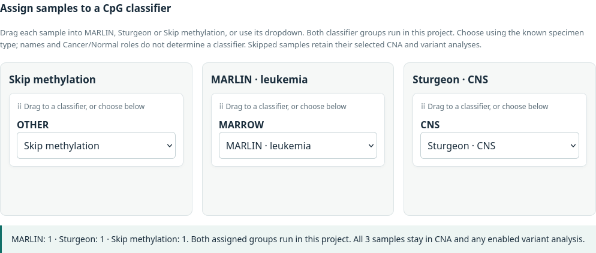

# Your first OncoTracer run

Use the browser setup if you are starting with your own data. You do not need to
edit a YAML file or collect paths to every analysis tool. OncoTracer creates the
configuration from your choices and checks it before enabling **Run analysis**.

## What you provide, and what OncoTracer prepares

| You provide or confirm | OncoTracer prepares or checks |
| --- | --- |
| Completed sequencing files and their locations | Discovers FASTQ files, groups lanes or ONT libraries, and checks that the selected files exist. Your original files stay in place. |
| Sample names, Cancer/Normal roles, and Fresh/FFPE preservation from your records | Writes the sample tables and `config/run.yml`. Sample names do not determine biological roles. |
| For methylation: the specimen tissue and suitable signal files | Checks the selected methylation inputs and prepares both classifiers when needed. You assign each sample to MARLIN, Sturgeon or Skip methylation. |
| Which analyses to run, including which samples should skip methylation | Saves those choices. Skipping methylation for a sample keeps its other selected analyses. |
| A project folder outside the input folders | Creates configuration and results folders. It can download a prepared hg38 reference or reuse a compatible reference you select. |
| Approval for a proposed tool installation and any required license acceptance | Installs the selected runtime, verifies it, and prepares permitted models and reference files. Completed downloads are reused. |
| Review of the suggested CPU, RAM and GPU allocation | Detects available hardware and offers allocation settings. CPU and RAM limits apply to the whole project. |

OncoTracer cannot recover sample identities, diagnoses, preservation methods or
sequencing chemistry from incomplete records. Review these choices yourself.
A methylation classifier score is a research result, not a diagnosis.

## 1. Install the small application

Use Linux x86-64, Python 3.10–3.13 and [Docker Engine](https://docs.docker.com/engine/install/).
Check that `docker info` works as your normal user. Docker Engine, operating-system
permissions and NVIDIA drivers must be prepared on the host; the browser does
not install or reconfigure them.

```bash
python3 -m venv oncotracer-env
source oncotracer-env/bin/activate
python -m pip install "https://github.com/cfarkas/oncotracer/releases/download/v6.3.0/oncotracer-6.3.0-py3-none-any.whl"
oncotracer interactive --backend docker
```

Keep this terminal open. If a browser does not open, copy the complete URL printed
in the terminal, including the part after `#`. For a remote server, follow
[the SSH instructions](headless.md#remote-browser-through-ssh).

You do not need Git, host R, Nextflow or host Conda for this Docker route. See
[installation and storage requirements](installation.md#requirements) before a
large run. Input files, references, the image and results all require disk space.

## 2. Review the automatic dependency check

The first card checks the installed application, Docker access, the selected
image and its tools. It also checks the latest published OncoTracer release.
Opening the page does not install software or start an analysis.

If something is missing, review the proposed image or installation folder, then
click **Install and verify**. The browser displays the progress and log. Wait
until verification finishes before using that runtime. **Stop** stops the
installer; **Retry** retries a failed installation. Existing download layers are
reused where possible.

An explicit custom or digest-pinned image is not silently replaced. If GitHub is
unreachable, local checks still run and the update status is reported as unknown.
If no supported runtime can be installed, the check gives the next command or
host prerequisite to fix. Advanced users can select [Conda](installation_details.md)
instead of Docker.

## 3. Select files and assign samples

Choose **Illumina** or **Oxford Nanopore**, then **Fresh** or **FFPE** from your
specimen records. Browse to the input folder and discover the FASTQs. Review the
sample list before assigning Cancer or Normal roles.

- **Illumina:** provide R1/R2 FASTQs for paired-end data. Multiple lanes can belong
  to one sample. Use a separate project for single-end data.
- **ONT:** each named library can have its own `fastq_pass` folder. Barcode-based
  MinKNOW runs and single libraries are also supported. Do not pool different
  patients into one library entry.

Rename samples if needed. The Cancer/Normal assignment controls their analysis
roles; custom labels still require a role. Input files are not renamed or moved.

## 4. Choose analyses and methylation inputs

Selecting ONT alone does not enable methylation. Under **Analysis**, choose
**CNA and methylation** to run both branches, or **Methylation classification**
for methylation alone. Variants are a separate option.

Drag each sample into one of the three groups, or use its dropdown:

- **MARLIN:** leukemia research in blood/marrow.
- **Sturgeon:** CNS tumor research.
- **Skip methylation:** other cancers, uncertain specimen types or samples without
  suitable signal. In a combined run, these samples keep CNA and selected variants.



*Version 6.3 setup with synthetic examples; no patient data or predictions.*

Both classifier groups run in the same project. Cancer/Normal roles and sample
names never assign a classifier automatically. Review the Sturgeon license and
accept it before using that classifier.

| What remains from the ONT run | What to select |
| --- | --- |
| Matching raw POD5 files, even if methylation was not called during sequencing | Choose **Rockfish** and the POD5 folder. OncoTracer can call methylation from compatible raw signal. |
| Matching BAMs containing `MM` and `ML` modified-base tags | Choose **Modkit** and the modified-base BAM input to reuse the recorded calls. |
| Only FASTQs or ordinary BAMs without modification tags; no POD5 | Choose **Continue without methylation**. CNA and selected variants can still run. |

Rockfish's managed profile requires compatible R10.4.1 E8.2, 400 bases/s, 5 kHz
signal. Confirm the flow cell and basecalling profile from sequencing records;
Fresh/FFPE is not a substitute for chemistry information. See the
[ONT input guide](launch.md#ont-with-methylation) for supported profiles.

The page shows the number assigned to each classifier and the number skipped.
**Save configuration and check** records the choices in
`config/methylation_assignments.tsv`, alongside `config/run.yml`. The review
shows **CNA**, **Small variants** and **Methylation** as enabled or off, followed
by each sample's classifier. The same assignments remain visible during the run.
If no sample needs methylation, click **Continue without methylation**.

A detected BAM filename does not prove that methylation calls exist. During
processing, OncoTracer checks matching reads and modification tags. If matching
reads have no recorded calls, it reports `methylation_unavailable` and produces
no methylation prediction for them. This is not a measurement of zero
methylation. Other usable samples and the selected CNA/variant analyses continue.
An input with mismatched read IDs remains an input error.

## 5. Review resources, save, and run

Choose a dedicated project folder outside the input folders. Keep automatic
reference preparation unless you already have a compatible reference cache.
Review the CPU/RAM allocation; do not allocate the same available memory to
several simultaneous projects. For GPU processing, the host also needs
[NVIDIA container support](gpu.md).

Docker supplies the supported caller environments. OncoTracer downloads required
references and managed models when they are needed. Sturgeon software/models
require your license acknowledgement and are downloaded privately. FFPErase also
requires acceptance of its terms for the relevant Illumina workflow. ANNOVAR is
optional and separately licensed: provide an existing permitted installation
if you want to use it. OncoTracer does not supply that license.

Click **Save configuration and check**. Review the sample list, analyses and
resource limits. Correct any reported errors, then click **Run analysis**.
Saving settings may prepare required resources; it does not start the sequencing
analysis. The first setup/run takes longer because downloads are not cached yet.
Follow progress and use **Open results** when outputs become available.

## 6. Keep or resume your project

The generated settings are in `PROJECT/config/run.yml`; results are in
`PROJECT/results`. Keep the configuration and logs with the results. The
[output guide](outputs.md) explains the reports and per-sample status files.

To resume from a terminal:

```bash
oncotracer run --config /full/path/to/PROJECT/config/run.yml --backend docker
```

Reuse the same version and recorded configuration for an existing result.
OncoTracer checks recorded outputs before reusing them. Use a new project for a
new sample selection or a comparison between versions.

## If setup cannot proceed

- **The image installed, but the page still shows an old version:** update the
  Python application in its active environment, save your work, and restart
  `oncotracer interactive`. Updating Docker does not update an already running
  launcher. Follow [the upgrade commands](installation.md#upgrade-the-launcher).
- **No methylation input:** turn methylation off for that sample, or select the
  matching POD5/MM/ML files. Do not substitute a CNA alignment BAM.
- **A download or installation failed:** read the displayed log, correct the
  reported cause, and retry. Do not delete completed caches just to retry.
- **Prefer terminal questions:** use `oncotracer setup --terminal --backend docker`.
  It checks dependencies and asks before installing them too.

For repeatable scripted runs, use [one sample table](launch.md). The extensive
[configuration reference](configuration/parameter_reference.md) is for advanced settings; it
is not a checklist of fields every new user must supply.
