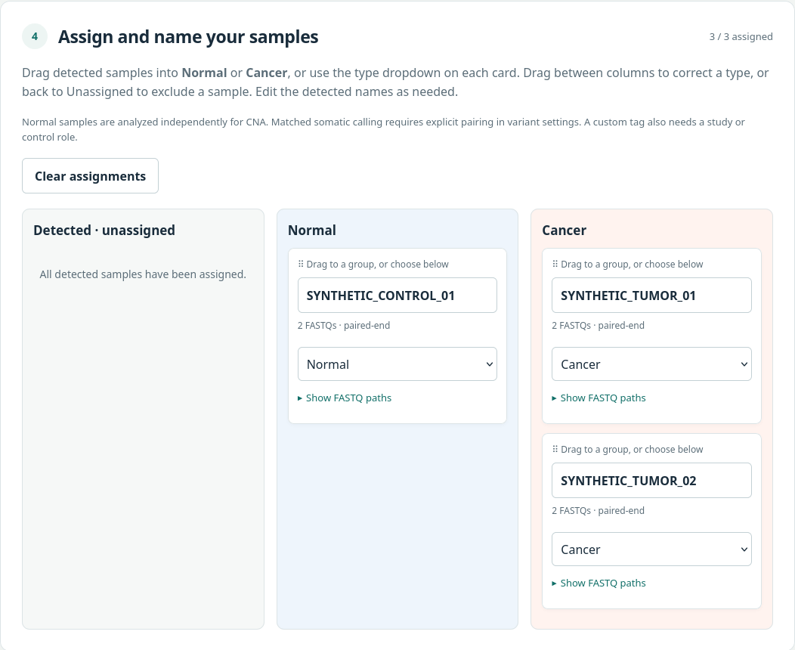

# OncoTracer

Analyze Illumina and Oxford Nanopore (ONT) reads for copy-number changes,
optional small variants, and ONT methylation research classifications.
Choose samples and settings in your browser, then follow the run to its results.
For research use.

## Quick start

Follow [your first run](first_run.md) for the recommended browser setup and a clear list of required inputs. For scripted runs, create [a sample table](launch.md),
then run:

```bash
oncotracer launch --samples samples.csv --project my-run --specimen fresh
```

Docker supplies the scientific tools. Launch prepares references and saves the
complete configuration. Use `--dry-run` to inspect inputs and resources first.
For a browser, run `oncotracer --interactive --backend docker`:

1. Review the dependency check and approve any needed installation.
2. Choose **Illumina or ONT**, then **Fresh or FFPE**.
3. Select your inputs, assign samples to Cancer or Normal, and choose a project folder.
4. Click **Save configuration and check**, review the checks, then **Run analysis**.

Opening setup does not start an analysis. Keep the launching terminal open while
using the browser, and use the complete URL it prints if the browser does not open.

## Watch a walkthrough

| Tutorial | What you will do |
| --- | --- |
| [QuickStart 1 — Illumina and ONT](quick_start.md) | Download a small public example and follow the video for either platform. |
| [QuickStart 2 — HCC1143](public_cohort.md) | Follow a video to set up three paired-end tumor libraries together. |
| [QuickStarts from the terminal](quickstart_terminal.md) | Run the same public examples from scripted commands. |

The videos use synthetic inventories and simulated checks; older recordings
predate the new dependency check and per-sample methylation controls. Each tutorial supplies real public downloads for your own analysis.

## Try the interface before installing

[](assets/setup-demo/index.html)

[Open the interactive demo](assets/setup-demo/index.html). It uses synthetic samples
and simulated progress; it does not run an analysis. See the [demo guide](browser_demo.md).

## Work with your own data

[Set up your samples](setup.md) or connect through [SSH](headless.md#remote-browser-through-ssh).
Separate projects can run in separate terminals at the same time, with distinct
output directories and CPU/memory budgets. Each browser session gets its own URL.

Use **Stop analysis** to stop a browser-started run. Closing the browser or setup
terminal leaves that analysis running. See [run, stop and resume](running.md) for
saved projects, valid-output reuse and progress, and [output files](outputs.md) for results.

## Explore further

[Small variants](variants.md) · [ANNOVAR annotation](annovar.md) ·
[ONT methylation](configuration/methylation.md) · [LLM-assisted reports](llm_reports.md) ·
[Manuscript figures](paper_report.md)

The [full public cohort](full_tutorial.md) provides a larger example.
[How OncoTracer works](native_architecture.md) explains the analysis;
[release validation](parity_release.md) records its checks.
[Uninstall](uninstall.md) separates application, tool and container removal.
